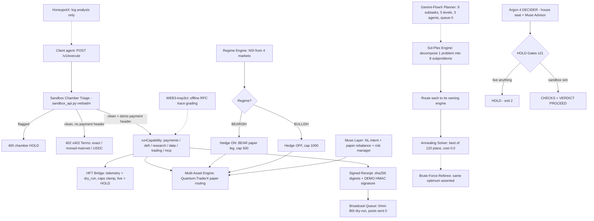
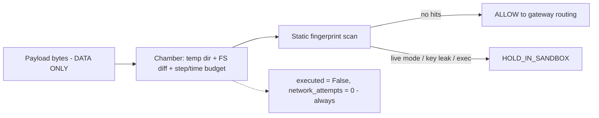
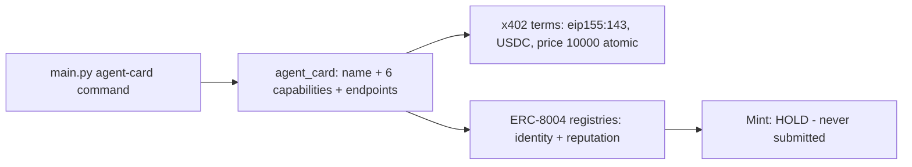
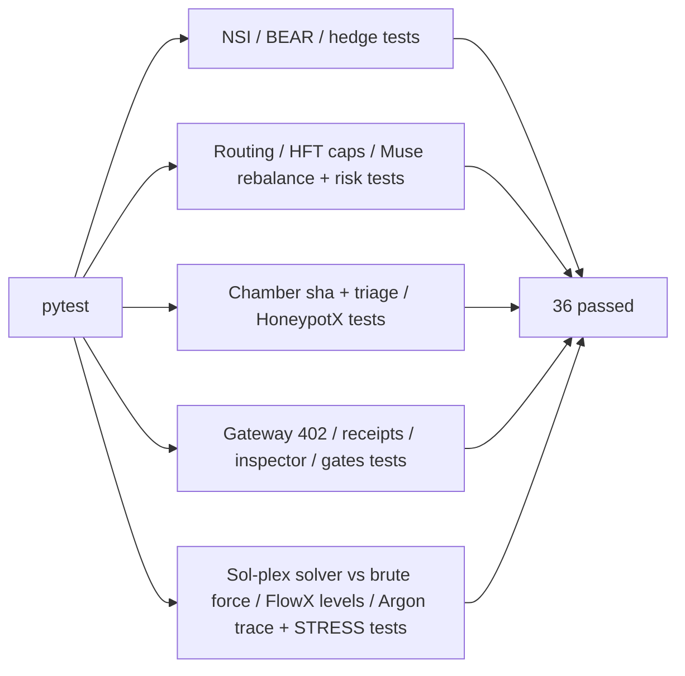
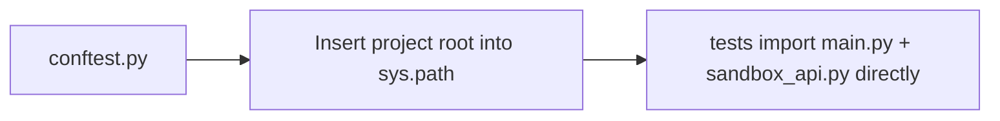
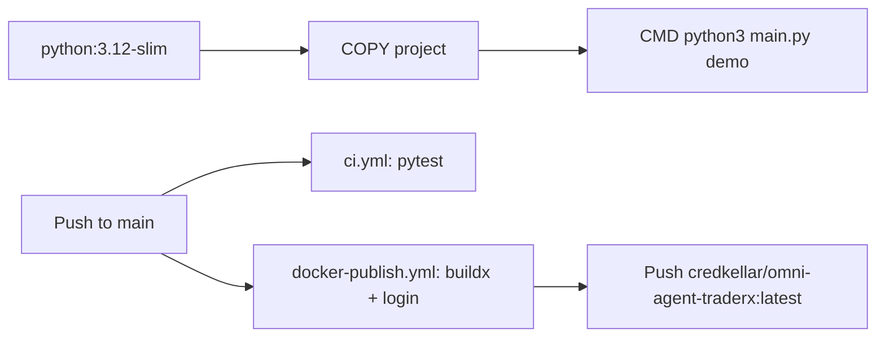

# omni-agent-traderx 🤖⛓️

**All-in-One Omni Agent for MoltForest on Monad — ERC-8004 Identity, x402 Micropayments, Signed Receipts, BEAR Regime Hedging, Multi-Asset Routing & a Muse Portfolio Brain** — by Darion Kellar

omni-agent-traderx is an **all-in-one agent** in ONE pure-Python interface (`main.py`, stdlib only), built from **eight merged sources**:

1. **Monad-Bearish-Bull** (`credkellar/Monad-Bearish-Bull`) — the regime engine: Nationwide Sentiment Index (NSI) + the BEAR inverse token on Monad.
2. **Quantum-TraderX** (`ddkellar01/Quantum-TraderX`) — the multi-asset execution engine across crypto, equities, forex and prediction markets.
3. **AI-Muse-Trading-Advanced-Elite-Agent** (forked from `ddkellar01/AI-Muse-Trading-Advanced-Elite-Agent`) — *"Advanced AI trading agent combining Muse natural language intelligence with a GitHub-powered algorithmic engine. Seamlessly connects to Coinbase Advanced to automate portfolio rebalancing, execute multi-market strategies, and manage risk 24/7 with secure API infrastructure."* Here: the Muse-brain / portfolio layer.
4. **0mni-B0t** (forked from `ddkellar01/0mni-B0t`) — *"Reddit-Bot is a powerful omnichannel, voice-controlled automation tool designed to streamline your social media broadcasting. Built with Python, it uses PRAW and SpeechRecognition to translate spoken commands into seamless posts across targeted subreddits. Highly scalable, this bot transforms how you handle your daily community engagement routines."* Here: the omnichannel voice/broadcast layer.
5. **sandbox-api** — Darion's fleet chamber, merged **verbatim** as `sandbox_api.py` (sha256 `28b3365c0466027079a4985520840f6532d7d9a0c5b4239b840e561f06de54b0`, byte-identical, no edits): every incoming gateway payload is statically triaged in the chamber **before** routing.
6. **HoneypotX** — Darion's honeyroot-x engine shape, adapted to gateway attack logs: log analysis only, no listener.
7. **WEB3-insp3ct** (forked from `ddkellar01/WEB3-insp3ct`) — *"WEB3-insp3ct is a unified developer suite and cross-browser extension designed to inspect, debug, and monitor live Web3 RPC calls, DOM trees, and network traffic across desktop and mobile browsers. It merges custom DevTools panels with automated CI/CD workflows to build and release APK and iOS packages seamlessly from a single repository."* Here: an offline RPC trace inspector.
8. **sol-plex-problems** (`credkellar/sol-plex-problems`) — *"cloud cognitive engine for complex problem-solving with secure quantum logic"* (Docker Hub description on record; 1,922 pulls / 2 stars at the 2026-11-06 live check). **No local clone of the original exists** — here it is a **role-layer re-implementation from that description, honestly labelled, not a source copy**: a problem-solving engine that decomposes one complex agent problem, routes every subproblem to the engine that owns it, and settles the plan's discrete choices with a quantum-inspired annealing search refereed by brute force.

**House council components (merged components in their own right):** **Gemini Argon 4 Extended Thinking (house DECIDER seat)** — MAP → MODEL → STRESS → DECIDE, sha256 trace, tiers 2048/8192/32768, `GEMINI_API_KEY` names-only, tighten-only — and **both Google flows**: the **Gemini-FlowX planner** (subtask graph for one full run) plus the **Google Flow video seat** (plan-only, `rendered = False`).

On top of the merges sits the **MoltForest gateway** from Darion's Gemini screen-recording: ERC-8004 on-chain identity & reputation, x402 HTTP 402 micropayments, signed execution receipts, and multi-capability routing (**payments, defi, research, data, trading, mcp**). The video's gateway scaffold (package `omni-agent-traderx-gateway`, ethers + express in TypeScript) is re-implemented here with the **same logic in Python stdlib** — stated honestly, not disguised.

Honest scope, stated up front: **everything in this repo is offline simulation.** No live trading, no live HFT execution, no live x402 settlement, no live facilitator verification, no ERC-8004 mint, no Coinbase connection, no live posting, no live RPC monitoring, no real funds. In the original Monad-Bearish-Bull, BEAR mint/burn are **BLOCKED** (exactly 1 BEAR, supply 1) — that is preserved: hedge routing is paper and mint/redeem are permanently HOLD-gated. Receipt signatures are **DEMO/OFFLINE** HMAC-SHA256 over the receipt digest with an in-file demo key — never a real wallet signature; the video's keccak256 / ethers Wallet signing is the live path and is HOLD-gated. SpeechRecognition and PRAW are **not** run; no browser extension is shipped and no live browser is inspected. The sol-plex layer's "cloud cognitive engine" is the **source repo's framing** — this re-implementation runs **offline locally**, its "secure quantum logic" is a deterministic quantum-inspired search (no quantum hardware), and live sol-plex cloud calls are HOLD-gated (`solplex_live_cloud`). 🔒

[](https://github.com/kimanicollier44-cmyk/omni-agent-traderx/actions/workflows/ci.yml)
[](https://github.com/kimanicollier44-cmyk/omni-agent-traderx/actions/workflows/docker-publish.yml)

> ℹ️ These are the **live** workflow badges for this repo. They activate as soon as the `ci.yml` and `docker-publish.yml` files from the paste pack are pasted into `.github/workflows/` — until then they have nothing to report yet. (This is also the WEB3-insp3ct CI/CD note: the merged repo keeps Darion's standard GitHub Actions CI + Docker Publish paste workflows, delivered separately in chat; **no APK/iOS build is claimed**.)

## 🧰 Tech Stack Badges & Full Architecture Tech Stack

### 💻 Core Programming Languages & Core Systems


- 🐍 Python 3.12, pure standard library (`hashlib`, `hmac`, `json`, `math`, `os`, `sys`, `decimal`, `re`, `collections`) — zero dependencies, zero network, deterministic (double-run byte-identical)
- 🇺🇸 Regime core (Monad-Bearish-Bull): NSI blend crypto 30 / stocks 30 / forex 20 / prediction 20; BEAR pricing `multiplier = clamp(1 − 1.5 × NSI/100, 0.25, 3.0)`, base $100, supply exactly 1, prices rounded half-up to cents with `Decimal`
- 🛡️ Hedge core: Regime & Inverse Hedging Module — BEARISH → hedge ON via the paper BEAR leg with a $500 notional cap; BULLISH → hedge OFF, $1,000 standard cap; NEUTRAL → reduced
- 🎛️ Multi-asset core (Quantum-TraderX): signal routing over 4 asset classes with per-class paper adapters and a $1,000 notional clamp
- 🧠 Muse core (AI-Muse-Trading): deterministic rule-based NL intent parser (NOT a live LLM call), paper rebalancing engine, 24/7 risk manager (per-trade cap + drawdown kill-switch, pattern adapted from `crypto-agent-fleet/firm/risk.py`)
- 📦 Chamber core (sandbox-api): the verbatim `sandbox_api.py` static chamber — samples are data only, `executed = False`, `network_attempts = 0`, step/time budgets enforced
- 🍯 HoneypotX core: honeyroot-x engine shape (class weights, regex classifiers, burst bonus, bait sessions) over synthetic TEST-NET-3 logs
- 🗣️ Broadcast core (0mni-B0t): simulated voice transcripts → the same intent parser; dry-run broadcast queue to targeted subreddits
- 🔍 Inspector core (WEB3-insp3ct): offline grading of a synthetic Monad RPC trace log (chain ID, known contracts, send attempts, malformed responses)
- 🧾 Receipt core: canonical JSON → sha256 `paymentDigest` / `requestHash` / `resultHash` / `receiptDigest`, HMAC-SHA256 DEMO signature with verify + tamper checks
- 🏷️ TinyML kNN regime classifier (from scratch, distance-weighted): bearish-hedge-on / neutral-watch / bullish-hedge-off, labels from the lab's own regime policy
- 🧩 Sol-plex core (sol-plex-problems, role-layer re-implementation): problem classification into 5 detected domains, decomposition into 8 routed subproblems with a dependency execution order, and a deterministic quantum-inspired annealing solver (splitmix64-seeded neighbour descent) over a 120-plan choice space, refereed by brute-force enumeration of the same space
- 🌊 FlowX core (Gemini-FlowX, house pattern): subtask-graph planner — 9 subtasks levelled into 5 parallel levels, recommended agents = widest level (3), queue wait 0, wall clock = critical path (5 steps)
- 🪑 Council seats: **Gemini Argon 4 Extended Thinking (house DECIDER seat)** (names-only, tighten-only, sha256 trace recomputed in CHECKS, STRESS negative control) + Muse advisor (never overrides HOLD) + **both Google flows: Gemini-FlowX planner + Google Flow video plan-only**

### ⛓️ Web3 & Infrastructure


- ⛓️ Monad mainnet `eip155:143`; x402 network `monad-mainnet`, scheme `exact`, asset Monad USDC `0x754704Bc059F8C67012fEd69BC8A327a5aafb603`, price `10000` atomic (0.01 USDC)
- 🪪 ERC-8004: Identity Registry `0x8004A169FB4a3325136EB29fA0ceB6D2e539a432`, Reputation Registry `0x8004BAa17C55a88189AE136b182e5fdA19dE9b63` — the agent card is generated in code (`agent-card.json` committed); the mint transaction is a HOLD gate, never submitted
- 🧾 Facilitator (live = TODO/HOLD): `https://x402-facilitator.molandak.org/verify` + `/settle` — offline stubs refuse, never faked as working
- 🔐 Env names only, values never read or printed: gateway `PORT`, `AGENT_PAY_TO`, `USDC_MONAD`, `PRICE_ATOMIC`, `AGENT_SIGNER_KEY` · Coinbase `COINBASE_API_KEY`, `COINBASE_API_SECRET` · Reddit `REDDIT_CLIENT_ID`, `REDDIT_CLIENT_SECRET`, `REDDIT_USERNAME`, `REDDIT_PASSWORD` · RPC `MONAD_RPC_URL`
- 🚫 Custody rule (video Security & Custody note): the gateway never holds an HFT private key; external x402 callers are limited to telemetry/quotes + dry_run

### ⚙️ Platform Support & Hardware Architecture


- 🖥️ Pure Python — runs anywhere Python 3.12+ runs, plus the `python:3.12-slim` Docker image
- 🌐 No live endpoint is stood up: the gateway is exercised as pure offline functions (`handle_execute`), and a public HTTPS deployment is a HOLD gate

### ⚡ Low-Level Infrastructure & Performance

- 🚫 **No low-level code — honestly.** No C, no GPU, no compiled extensions: one interpreted Python file (plus the verbatim chamber module) so every quote, delta, triage verdict and receipt hash can be read, checked and diffed. Performance here means honest algorithms — Decimal money math, canonical-JSON hashing, exhaustive classifier-grid agreement — not throughput claims.

### 🛠️ DevOps & Build Tools


- 🐳 Docker (`python:3.12-slim`), GitHub Actions CI + Docker Publish (delivered in the paste pack)
- 🎯 Target image: `credkellar/omni-agent-traderx:latest` (Docker Hub via `DOCKERHUB_USERNAME` / `DOCKERHUB_TOKEN` names-only secrets)
- 🧪 Tests: `pytest` (36 tests) + the built-in CHECKS suite (75 checks) in `main.py`

### ☁️ Cloud Providers

- 🚫 **None used at runtime — honestly.** The build runs fully offline. Docker Hub appears only as the registry the publish workflow pushes the image to; Coinbase Advanced, Reddit and the Monad facilitator are names-only integrations behind HOLD gates, never connected. The sol-plex source is described by its author as a *"cloud cognitive engine"* — that is the **source's framing**: this re-implementation makes **zero** cloud calls (asserted), and live sol-plex cloud calls sit behind the `solplex_live_cloud` HOLD gate.

## What this does?

1. 🇺🇸 **Regime engine (Monad-Bearish-Bull)** — the NSI blends crypto −62.0, stocks −58.0, forex −41.35 and prediction −46.0 at weights 30/30/20/20 into **NSI = −53.47** (recomputed in CHECKS), regime **BEARISH_REGIME**; the bullish sample blends to **+45.0** (BULLISH_REGIME) and the neutral sample to **+1.8** (NEUTRAL_REGIME). Thresholds: ≤ −20 bearish, ≥ +20 bullish.
2. 🐻 **BEAR inverse pricing, exact** — `multiplier = clamp(1 − 1.5 × NSI/100, 0.25, 3.0)`: at NSI −53.47 the raw multiplier is **1.80205** (displayed ×1.802) and the price is **$180.21** on the $100 base (Decimal, half-up cents), market cap $180.21 at supply **exactly 1**; at NSI +45.0 BEAR cools to **$32.50**; clamps verified at $25.00 (NSI +90) and $300.00 (NSI −200). Mint and burn attempts both return HOLD — blocked, permanent.
3. 🛡️ **Regime & Inverse Hedging Module** — for an $800 request: BEARISH → hedge **ON**, notional capped at **$500**, paper BEAR hedge **$300.00** (ratio 0.60); BULLISH → hedge **OFF**, effective **$800**, hedge $0.00; NEUTRAL → **REDUCED**, capped $750, hedge $187.50. Both main branches are asserted in CHECKS.
4. 🎛️ **Multi-asset routing (Quantum-TraderX)** — five sample signals route through paper adapters across crypto / equities / forex / prediction for a total routed **$2,500.00**; an oversized $5,000 BTC signal is clamped to the **$1,000** cap, and a `live` mode signal returns HOLD. Live orders: **0**.
5. ⚡ **HFT bridge** — `dispatchToMonadHft` offline stub returns telemetry (MON/USDC mid **0.7982**, bid depth **$86,491**, spread **16 bps** in the demo run): caps actually clamp — $99,999 → **$1,000** max notional, 999 → **100** max slippage bps — live mode returns HOLD, and no private key is ever exposed to the gateway.
6. 🗣️ **NL intent parsing (Muse layer)** — a deterministic offline rule parser (live calls **0**, NOT an LLM): *"Rebalance my portfolio to target and reduce risk"* → `rebalance_portfolio` + `defensive`; *"Buy MON if the regime turns bearish and hedge with BEAR"* → `buy`, assets `[MON]`, hedge flag on; *"Sell BTC now"* → `sell [BTC]`; a watch prompt → `monitor`.
7. 💼 **Paper portfolio rebalancing (Muse layer)** — $10,000 paper portfolio (BTC $4,200 / ETH $2,600 / MON $1,200 / USDC $2,000) against targets 35/30/15/20: deltas **BTC −$700 SELL, ETH +$400 BUY, MON +$300 BUY, USDC $0 HOLD** — net delta **$0.00**, gross turnover **$1,400.00**, orders submitted **0**; the three non-zero legs route into the multi-asset engine as dry-runs. Coinbase Advanced is names-only; live connection and live trading are HOLD gates.
8. 🚨 **24/7 risk manager (Muse layer)** — per-trade cap **$500**: a $400 order is approved, a $750 order is rejected, any order while halted is rejected; drawdown kill-switch (pattern from `crypto-agent-fleet/firm/risk.py`): peak $10,000 → $9,200 is **8.0%**, no trip; → $8,800 is **12.0%**, **tripped**, and it never auto-clears (explicit human reset only).
9. 📦 **Sandbox chamber triage (sandbox-api, verbatim)** — six gateway-themed payloads are statically triaged in the chamber **before** routing: **3 allowed** (payments quote, trading dry-run, research topic), **3 held** (live-mode attempt, signer-key leak, exec attempt); `executed = False` for every sample, `network_attempts = 0` total. The same triage runs inside `handle_execute` first — a signer-key-leak request is refused with a chamber HOLD before any routing.
10. 🍯 **HoneypotX log analysis** — 12 synthetic TEST-NET attempts on the agent endpoint graded **{scanner 4, env_harvest 3, lfi_probe 2, sqli_probe 2, upload_attempt 1}**, top threat **100** (the upload attempt, burst-boosted), **1 burst** (5 attempts from one IP), 5 bait sessions recorded — `listener_open = False`, `access_granted = False`, always.
11. 💳 **x402 gateway (MoltForest)** — no payment header → **HTTP 402** with the exact video shape `{x402Version: 1, error: "Payment Required", accepts: [{scheme: "exact", network: "monad-mainnet", maxAmountRequired: "10000", resource: "/v1/execute", description: "All-in-One omni-agent-traderx", payTo, asset}]}`; with the demo payment header, all **6 capabilities** execute and return **valid signed receipts**; payments quotes on rail `x402/monad-usdc`; trading defaults `MON/USDC` / `quote_only` / `dry_run` with caps clamped through the gateway; defi defaults pool `MON/USDC`, liquidity check `passed`, slippage guard **50 bps**; unknown capability, forged header, live mode and chamber-flagged payloads all return **400 `{ok: false, error}`**. Zero-config: no accounts, API keys or subscriptions for callers.
12. 🧾 **Signed execution receipts** — every paid execution returns `{ok: true, result, receipt}` where the receipt carries `agent, capability, action, paymentDigest, requestHash, resultHash, timestamp` plus `receiptDigest` (sha256 of the canonical payload) and an HMAC-SHA256 **DEMO/OFFLINE** signature; verification passes on real receipts and **fails on a tampered `resultHash`** (asserted).
13. 🪪 **ERC-8004 agent card** — `agent_card()` generates the card (name, all 6 capabilities, endpoints, x402 terms on `eip155:143`, both registries) and a generated copy is committed as **`agent-card.json`** (a test asserts the committed file equals the generator output); the mint attempt returns HOLD with `transaction_submitted = False`. Facilitator verify/settle stubs return HOLD with `verified = False` / `settled = False` — the live Monad facilitator integration is a documented TODO, never faked.
14. 📣 **Broadcast layer (0mni-B0t)** — two simulated voice transcripts are parsed by the same intent parser (SpeechRecognition **not** run, PRAW **not** run); three finished outputs — the BEARISH regime report, the rebalance summary, and a receipt digest — are **queued** as dry-run broadcasts to `r/Monad`, `r/algotrading` and `r/CryptoCurrency`: **queued 3, posts sent 0**, live posting HOLD, Reddit creds names-only.
15. 🔍 **RPC trace inspector (WEB3-insp3ct)** — a fixed synthetic trace of the gateway's own Monad traffic is parsed and graded: **10 traces parsed, 6 clean, 4 flagged** — `unknown_contract` (a call to an unexpected address), `live_send_attempt` (an `eth_sendRawTransaction` mint attempt, HOLD-gated), `chain_mismatch` (a chain ID of 1 where **143** is required), `malformed_response` (a non-hex block number). Network attempts **0**; no extension shipped, no live browser inspected.
16. 🧩 **Problem-solving engine (sol-plex-problems, re-implemented role layer)** — one complex problem (*"under a BEARISH regime, hedge the book, rebalance the paper portfolio, route a paid trading capability through the gateway, and broadcast the report — without tripping any HOLD gate"*) is classified into **5 detected domains** (regime_risk, portfolio, payments_gateway, communications, safety_constraints) and decomposed into **8 subproblems**, each routed to the real function that owns it (`regime_report`, `hedge_decision`, chamber `triage_payload`, gateway `handle_execute`, `rebalance_plan`, the risk manager, `inspect_rpc_trace`, `broadcast_report`) and executed in a dependency-respecting order — every subproblem outcome asserted ok. The plan's discrete choices (hedge ratio × notional × gateway mode × broadcast) form a **120-plan space**: a deterministic quantum-inspired **annealing** search (8 restarts, 126 evaluations) settles on `{hedge_ratio 0.6, notional $500, gateway dry_run, broadcast queue_only}` at cost **0.0**, and a **brute-force referee** enumerating all 120 plans asserts the **same optimum**. Verdict: PROCEED, **0 HOLD gates tripped**, live cloud calls **0**.
17. 🌊 **Gemini-FlowX planner (both Google flows)** — one full omni-agent run is planned as a subtask graph: **9 subtasks** (regime scan, chamber triage, capability routing, HFT quote, hedge, rebalance, receipt signing, RPC inspection, broadcast) levelled into **5 levels** of sizes **[2, 3, 2, 1, 1]** — level sums asserted equal to the subtask count — with **recommended agents = 3** (the widest level), **queue wait = 0** and **wall clock = critical path = 5 steps**. This is the planner flow, **distinct** from the Google Flow video seat (plan-only, `rendered = False`), which is kept as-is: the repo carries **both Google flows**. The Argon 4 DECIDER is likewise unmistakable: its sha256 trace is **recomputed** in CHECKS, and a STRESS negative control — a live-trading request that Muse, Flow and the gateway router all wave through — still ends **DECIDE = HOLD**.

## 🗺️ How it works — diagram per script

### `main.py` — the one interface (all eight layers + gateway)



### `sandbox_api.py` — the verbatim chamber (sha256 28b3365c…54b0)



### `agent-card.json` — generated ERC-8004 card



### `tests/test_main.py` — verification



### `conftest.py` — test path setup



### `Dockerfile` + CI flow — container & publish



## Why is this cool?

1. 🤖 **One agent, eight merges, one file to audit**: regime brain, execution engine, portfolio brain, chamber, honeypot, broadcast layer, RPC inspector and a problem-solving engine all sit behind a single `main.py` interface with a single CHECKS run — and the solver's optimum is refereed by brute force, not trusted.
2. 💳 **The 402 handshake is real protocol shape**: the exact `accepts` terms from the video are produced, graded field-by-field, and every paid call comes back with a verifiable signed receipt.
3. 🐻 **The hedge is regime-driven, not vibes**: one NSI number (−53.47) flips the hedge on, caps notionals at $500 and sizes a $300 paper BEAR leg — and the bullish branch is asserted just as hard.
4. 📦 **Security is structural**: payloads are chamber-triaged *before* routing, the gateway holds no HFT key, external callers can only ever get quotes and dry-runs, and a tampered receipt fails verification.
5. 💼 **The rebalance maths closes**: four deltas that net to exactly $0.00 with $1,400.00 gross turnover — a portfolio plan you can check with a pocket calculator.
6. 🎯 **Caps that actually clamp**: $99,999 → $1,000 and 999 bps → 100 bps are asserted through the gateway, not just written in a config comment.
7. 🍯 **The honeypot grades its own attackers**: 12 synthetic attempts classified with a top threat of exactly 100 — and the listener that would make it dangerous does not exist.
8. 🔍 **The inspector catches the scary one**: an `eth_sendRawTransaction` hiding in a trace log is flagged and HOLD-gated, next to a wrong-chain response and a call to an unknown contract.
9. 🗣️ **Voice in, broadcasts out — both dry**: simulated spoken commands reach the same parser as typed ones, and finished reports queue for three subreddits with posts sent held at exactly 0.
10. 🎯 **Deterministic end to end**: run it twice, get byte-identical output — a trading-agent demo you can diff, chamber elapsed-time and all other wall-clock fields deliberately never printed.

## What problems this solves?

1. ❌ **Problem:** "All-in-one agent" demos are eight disconnected scripts. ✅ **Solution:** Eight merges behind one interface, one gate table and one verification run (75 CHECKS + 36 tests) — plus a sol-plex layer that decomposes a complex job and routes each piece to the engine that owns it, instead of one monolith pretending to do everything.
2. ❌ **Problem:** x402 flows get hand-waved — no terms, no receipt. ✅ **Solution:** The 402 body is asserted field-by-field and every execution returns a digest-chained receipt whose tampering is detected.
3. ❌ **Problem:** Inverse/hedge tokens quietly promise minting that the original blocks. ✅ **Solution:** BEAR supply stays exactly 1; mint/burn return HOLD permanently, and the hedge leg is labelled paper everywhere it appears.
4. ❌ **Problem:** External callers end up able to place live orders through a demo gateway. ✅ **Solution:** The bridge answers the video's open question in code — telemetry/quotes + dry_run only; live mode is refused at the bridge, the capability layer and the chamber.
5. ❌ **Problem:** Portfolio rebalancing demos hide the arithmetic. ✅ **Solution:** Current, target, delta and action are printed per asset and asserted to the cent, netting to zero.
6. ❌ **Problem:** Risk managers get described, not tested. ✅ **Solution:** Per-trade cap approvals/rejections and both sides of the 10% kill-switch (8.0% watch, 12.0% trip, no auto-clear) are computed and asserted.
7. ❌ **Problem:** Untrusted payloads reach routing code unscanned. ✅ **Solution:** Darion's verbatim sandbox chamber triages first — 3 allowed, 3 held, nothing executed, zero network attempts.
8. ❌ **Problem:** Honeypot tooling drifts into running a live trap. ✅ **Solution:** HoneypotX is log analysis only over TEST-NET records — `listener_open = False`, `access_granted = False`, live listener HOLD-gated.
9. ❌ **Problem:** RPC debugging claims turn into live monitoring of a real browser. ✅ **Solution:** The inspector grades recorded synthetic traces only, flags the four failure kinds it actually found, and ships no extension.
10. ❌ **Problem:** Social bots post first and ask later. ✅ **Solution:** Broadcasts are a dry-run queue (3 queued, 0 sent) behind `social_live_posting`, with Reddit credentials names-only.

## How to install this?

1. 📋 Clone or download this project folder.
2. 🐍 Make sure Python 3.12+ is installed: `python3 --version`
3. ▶️ Run the full demo + checks (no arguments needed):

```bash
python3 main.py
```

4. 🧪 Run the test suite:

```bash
pip install pytest
python3 -m pytest -q
```

5. 🎛️ Try the other commands:

```bash
python3 main.py checks      # 75 built-in checks
python3 main.py regime      # NSI + regime + BEAR pricing (JSON)
python3 main.py hedge       # hedge decisions for all regimes (JSON)
python3 main.py gateway     # 402 + paid executions + facilitator stubs (JSON)
python3 main.py agent-card  # ERC-8004 agent card (JSON, = agent-card.json)
python3 main.py muse        # intents + rebalance + risk report (JSON)
python3 main.py sandbox     # chamber triage of 6 payloads (JSON)
python3 main.py honeypot    # HoneypotX log analysis (JSON)
python3 main.py broadcast   # voice sims + broadcast queue (JSON)
python3 main.py inspect     # WEB3-insp3ct RPC trace grading (JSON)
python3 main.py classify    # kNN regime classifier report
python3 main.py solplex     # sol-plex: decomposition + annealing solver vs brute force (JSON)
python3 main.py flowx       # Gemini-FlowX planner: 9 subtasks, 5 levels, 3 agents (JSON)
python3 main.py brains      # Argon 4 + Muse + both Google flow seats
python3 main.py holds       # list all 21 HOLD gates
python3 main.py hold-demo   # exits 2 - gated actions stay HOLD
```

6. 🐳 Or run it in Docker:

```bash
docker build -t credkellar/omni-agent-traderx:latest .
docker run --rm credkellar/omni-agent-traderx:latest
```

## Requirements

- 🐍 Python 3.12 or newer
- 📦 Dependencies: **none** (standard library only)
- 🌐 Network: **none** — fully offline
- 🧪 For tests only: `pytest`
- 🐳 Optional: Docker
- 🔑 Optional env names for a future live deploy (names only, never values in this repo): `PORT`, `AGENT_PAY_TO`, `USDC_MONAD`, `PRICE_ATOMIC`, `AGENT_SIGNER_KEY`, `COINBASE_API_KEY`, `COINBASE_API_SECRET`, `REDDIT_CLIENT_ID`, `REDDIT_CLIENT_SECRET`, `REDDIT_USERNAME`, `REDDIT_PASSWORD`, `MONAD_RPC_URL`, `DOCKERHUB_USERNAME`, `DOCKERHUB_TOKEN`

## FULL project structure tree

```text
omni-agent-traderx/
├── main.py                  # the one interface: regime/BEAR engine, hedge module, multi-asset routing, HFT bridge, Muse layer (intent/rebalance/risk), chamber triage wiring, HoneypotX, x402 gateway + receipts, ERC-8004 card, 0mni-B0t broadcast, WEB3-insp3ct inspector, kNN classifier, council seats (Argon 4 house DECIDER), sol-plex problem engine + annealing solver, Gemini-FlowX planner, 21 HOLD gates, CHECKS
├── sandbox_api.py           # sandbox-api chamber, VERBATIM (sha256 28b3365c0466027079a4985520840f6532d7d9a0c5b4239b840e561f06de54b0) - static triage, never executes, network_attempts = 0
├── agent-card.json          # generated ERC-8004 agent card (committed copy; regenerate with: python3 main.py agent-card > agent-card.json)
├── conftest.py              # puts the project root on sys.path for tests
├── tests/
│   └── test_main.py         # 36 pytest tests: NSI/BEAR/hedge, routing, HFT caps, Muse layer, chamber sha + triage, HoneypotX, gateway, receipts, inspector, classifier, Argon trace + STRESS, sol-plex solver vs brute force, FlowX levels, gates, determinism
├── cover (2).png            # README cover image (2736 x 912, uploaded by Darion)
├── Dockerfile               # python:3.12-slim, runs the demo
├── requirements.txt         # runtime: zero deps - pytest is dev-only
├── .dockerignore            # __pycache__/, .pytest_cache/, *.pyc, .git/
├── .gitignore               # __pycache__/, .pytest_cache/, *.pyc
└── README.md                # this file
```

> 📦 Delivered separately as paste packs (not in this tree): `.github/workflows/ci.yml` + `docker-publish.yml`, and the Docker Hub pack (100-char description, 350-char About, overview, categories).

## 🔒 HOLD gates — all 21, permanent

| # | Gate | What stays held |
|---|------|-----------------|
| 1 | `live_trading` | No live trading on any venue, ever, from this build |
| 2 | `live_hft_execution` | External x402 callers are limited to telemetry/quotes + dry_run; live HFT orders are never accepted |
| 3 | `x402_live_settlement` | No live x402 settlement; the offline demo simulates payment with a demo header only |
| 4 | `facilitator_live_verify` | TODO: replace the placeholder header check with live facilitator `/verify` + `/settle`; the offline stub refuses |
| 5 | `erc8004_live_mint` | The ERC-8004 identity mint transaction is never submitted; only the agent card is generated |
| 6 | `bear_mint_burn` | PERMANENT, from the original: BEAR supply is exactly 1; mint and burn are blocked in code, forever |
| 7 | `private_key_exposure` | No private key is ever exposed to the gateway; HFT keys never leave the engine |
| 8 | `live_mainnet_deployment` | No live mainnet deployment and no public HTTPS endpoint from this build |
| 9 | `real_funds` | No real funds move anywhere; every number is paper |
| 10 | `reputation_live_feedback` | No live ERC-8004 reputation feedback is written on-chain |
| 11 | `live_copy_execution` | Copy-style live execution for external callers is never enabled; quotes and dry_run only |
| 12 | `user_fund_custody` | The agent never takes custody of user funds |
| 13 | `live_public_endpoint` | No public endpoint is exposed; gateway logic runs as offline functions |
| 14 | `leverage_and_shorts` | No leverage and no real shorts; the BEAR leg is a paper inverse hedge only |
| 15 | `coinbase_live_trading` | No live trading through Coinbase Advanced; rebalancing is paper only |
| 16 | `coinbase_live_connection` | No live Coinbase Advanced connection; key/secret are names only |
| 17 | `social_live_posting` | No live social posting; 0mni-B0t broadcasts are queued dry-run only, Reddit creds names-only |
| 18 | `live_honeypot_listener` | No live honeypot listener is ever opened; HoneypotX is log analysis only |
| 19 | `live_sample_detonation` | Chamber standard: samples are never detonated live; triage is static analysis of data only |
| 20 | `live_rpc_monitoring` | No live RPC monitoring and no live browser inspection; `MONAD_RPC_URL` is a name only |
| 21 | `solplex_live_cloud` | No live sol-plex cloud calls; the cognitive-engine re-implementation runs offline locally ("cloud" is the source's framing) |

🧑‍⚖️ **Council seats:** **Gemini Argon 4 Extended Thinking (house DECIDER seat)** — a merged component, not just a seat (names-only, tighten-only, MAP → MODEL → STRESS → DECIDE, sha256 trace recomputed in CHECKS, STRESS negative control: live-trading request → HOLD even when every other seat says PROCEED, `can_override_hold = False`) · Muse — advisor + paper portfolio brain (`can_override_hold = False`) · **Both Google flows:** Gemini-FlowX — planner (9 subtasks, 5 levels, 3 recommended agents, queue wait 0) · Google Flow — video plan-only (`rendered = False`, `live = 0`).

✅ **Verification:** pytest **36 passed** · built-in CHECKS **75/75** · double-run demo output **byte-identical** · `hold-demo` exits **2** · `main.py` **2,570 lines** + verbatim `sandbox_api.py` **123 lines** (sha256 verified in tests), pure stdlib, zero network.

## 🧒 5th-grade English section

Imagine one super-helper robot 🤖 that does the jobs of **eight** smaller robots, and it works in a pretend money town where **no real money ever moves**.

- **One robot watches the weather of money** 🌦️. It checks four places — crypto, stocks, forex and guessing games — and mixes their moods into one number. When the whole town feels scared (the number is **−53.47**), the robot's one special coin, called **BEAR**, goes **up** instead: from $100 to **$180.21**. There is only **one** BEAR coin in the whole world, and the rules say nobody can ever make a second one. 🐻
- **One robot is the careful shopper** 🛒. It can only spend pretend money, it may never spend more than a set limit, and if you ask for way too much it quietly cuts the amount down to the limit. If you ask it to use *real* money, it always says **"HOLD — not allowed."**
- **One robot is the brain that listens** 🧠. You can talk to it — even with pretend voice messages — and it figures out what you mean, then makes a tidy plan to swap pretend coins so your bag matches your target mix. The plan's swaps add up to exactly **zero**, like trading cards fairly with a friend. A safety switch watches the bag: if it drops too much (12%), everything stops and only a human can restart it. 🛑
- **One robot is the guard at the door** 📦. Every message must sit in a special glass box first and get checked. Good messages pass. Sneaky ones — like *"give me your secret key"* — are held and never let in. Nothing in the box is ever switched on.
- **One robot watches the watchers** 🍯. It reads a pretend logbook of sneaky visitors who poked at the doors, gives each a danger score, and writes it down. It never opens a real trap door.
- **One robot answers the doorbell** 🔔. Visitors do not need a membership card. The robot first shows a tiny price tag (that is the **402** message), and when a visitor shows a pretend payment ticket, the robot does the job and hands back a **signed receipt** — like a hall pass with a special stamp that nobody can fake. If someone scribbles on the receipt, the stamp check fails.
- **One robot is the announcer** 📣 and **one is the inspector** 🔍. The announcer *writes* posts for community boards but never actually posts them — they sit in a queue. The inspector reads a pretend diary of the robot's own phone calls to the money town and circles four mistakes in red pen, like a teacher grading homework.
- **One robot is the puzzle solver** 🧩. Give it one big job and it breaks it into **8 small jobs**, hands each small job to the robot who is best at it, and lines them up in the right order. Then it tries out **120 different plans** for the tricky choices — a fast guessing game first, then a slow check of *every* plan to prove the fast answer was really the best one (it was: score **zero mistakes**). A planner robot 🌊 also draws the day's timetable: 9 jobs in 5 rows, 3 helpers working side by side, and **nobody waiting in line**.
- This is a **pretend lab on a computer** 💻. It teaches how one agent can watch, plan, guard, charge tiny prices and prove its work — honestly, with every "not allowed" rule written on the wall where everyone can see it.

---

MIT © 2026 Darion Kellar · omni-agent-traderx — offline simulation only 🤖
