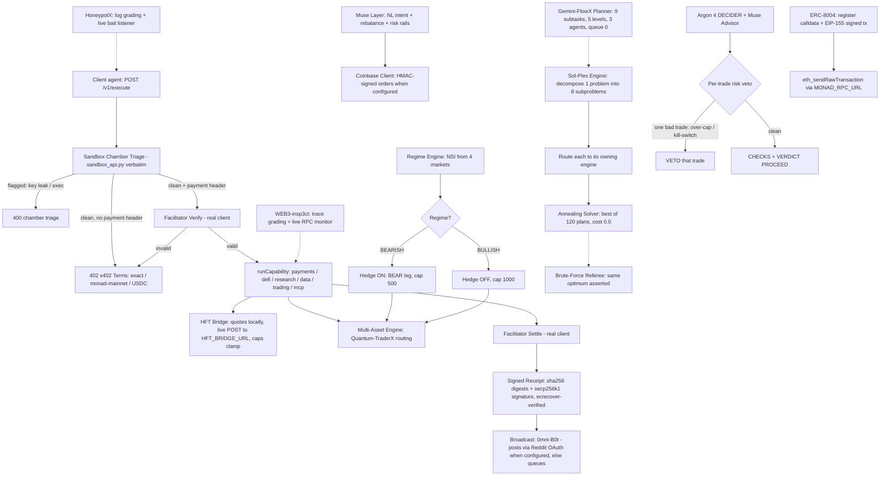
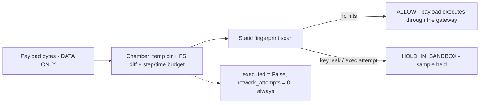
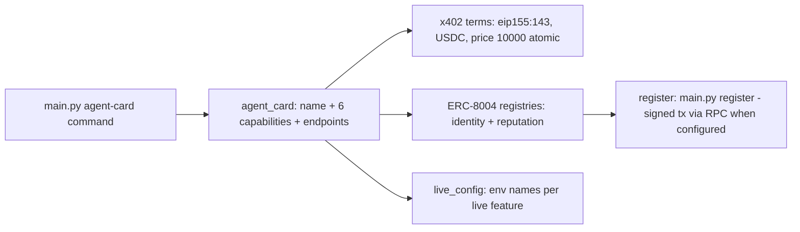
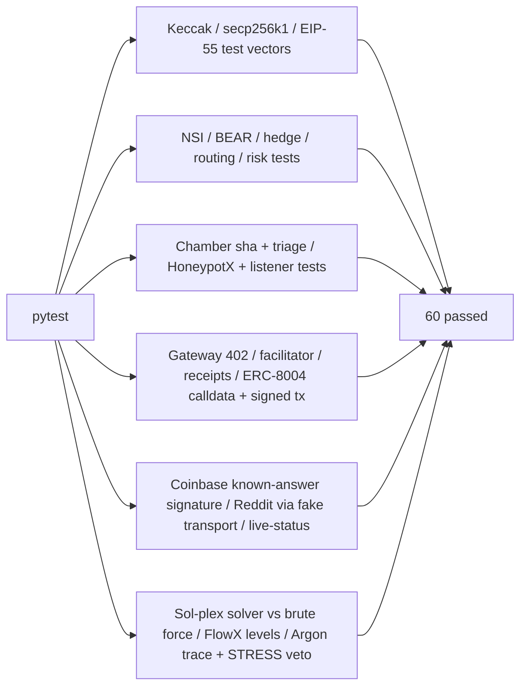
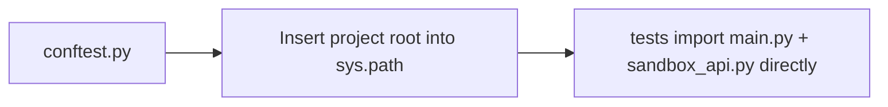
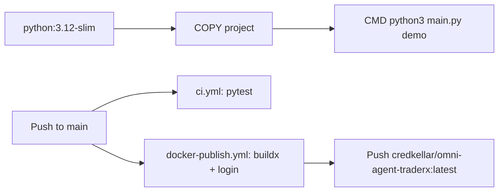

# omni-agent-traderx 🤖⛓️

**Fully Functional All-in-One Monad Agent — ERC-8004 Identity, x402 Micropayments, secp256k1-Signed Receipts, BEAR Regime Hedging, Multi-Asset Routing & a Muse Portfolio Brain** — by Darion Kellar

**Fully functional all-in-one Monad agent. Live paths activate on your own credentials (env); the offline demo + test-vector suite verifies every flow without them.**

omni-agent-traderx is an **all-in-one agent** in ONE pure-Python interface (`main.py`, stdlib only), built from **eight merged sources**:

1. **Monad-Bearish-Bull** (`credkellar/Monad-Bearish-Bull`) — the regime engine: Nationwide Sentiment Index (NSI) + the BEAR inverse token on Monad.
2. **Quantum-TraderX** (`ddkellar01/Quantum-TraderX`) — the multi-asset execution engine across crypto, equities, forex and prediction markets.
3. **AI-Muse-Trading-Advanced-Elite-Agent** (forked from `ddkellar01/AI-Muse-Trading-Advanced-Elite-Agent`) — *"Advanced AI trading agent combining Muse natural language intelligence with a GitHub-powered algorithmic engine. Seamlessly connects to Coinbase Advanced to automate portfolio rebalancing, execute multi-market strategies, and manage risk 24/7 with secure API infrastructure."* Here: the Muse-brain / portfolio layer, with a **working Coinbase client** behind it (auth scheme stated honestly below).
4. **0mni-B0t** (forked from `ddkellar01/0mni-B0t`) — *"Reddit-Bot is a powerful omnichannel, voice-controlled automation tool designed to streamline your social media broadcasting. Built with Python, it uses PRAW and SpeechRecognition to translate spoken commands into seamless posts across targeted subreddits. Highly scalable, this bot transforms how you handle your daily community engagement routines."* Here: the omnichannel voice/broadcast layer — broadcasts **post for real** when the four `REDDIT_*` env vars are configured, and queue otherwise.
5. **sandbox-api** — Darion's fleet chamber, merged **verbatim** as `sandbox_api.py` (sha256 `28b3365c0466027079a4985520840f6532d7d9a0c5b4239b840e561f06de54b0`, byte-identical, no edits): every incoming gateway payload is statically triaged in the chamber **before** routing — and payloads the chamber **approves now execute for real** through the gateway.
6. **HoneypotX** — Darion's honeyroot-x engine shape over gateway attack logs, **plus a real bait listener** (`honeypot-listen`, stdlib `http.server`) that serves decoy responses and grades every attempt with the same classifier.
7. **WEB3-insp3ct** (forked from `ddkellar01/WEB3-insp3ct`) — *"WEB3-insp3ct is a unified developer suite and cross-browser extension designed to inspect, debug, and monitor live Web3 RPC calls, DOM trees, and network traffic across desktop and mobile browsers. It merges custom DevTools panels with automated CI/CD workflows to build and release APK and iOS packages seamlessly from a single repository."* Here: the offline RPC trace inspector (demo) **plus live RPC monitoring** via `MONAD_RPC_URL`.
8. **sol-plex-problems** (`credkellar/sol-plex-problems`) — *"cloud cognitive engine for complex problem-solving with secure quantum logic"* (Docker Hub description on record; 1,922 pulls / 2 stars at the 2026-11-06 live check). **No local clone of the original exists** — here it is a **role-layer re-implementation from that description, honestly labelled, not a source copy**: a problem-solving engine that decomposes one complex agent problem, routes every subproblem to the engine that owns it, and settles the plan's discrete choices with a quantum-inspired annealing search refereed by brute force.

**House council components (merged components in their own right):** **Gemini Argon 4 Extended Thinking (house DECIDER seat)** — MAP → MODEL → STRESS → DECIDE, sha256 trace, tiers 2048/8192/32768, `GEMINI_API_KEY` names-only. Its power is a **per-trade risk veto**: it can block one specific bad trade (over-cap, kill-switch tripped), which is risk management deciding — it cannot disable a feature. Plus **both Google flows**: the **Gemini-FlowX planner** (subtask graph for one full run) and the **Google Flow video seat** (plan-only, `rendered = False`).

On top of the merges sits the **MoltForest gateway** from Darion's Gemini screen-recording: ERC-8004 on-chain identity & reputation, x402 HTTP 402 micropayments, signed execution receipts, and multi-capability routing (**payments, defi, research, data, trading, mcp**). The video's gateway scaffold (package `omni-agent-traderx-gateway`, ethers + express in TypeScript) is re-implemented here with the **same logic in Python stdlib** — stated honestly, not disguised. Where the video used ethers' keccak256 / Wallet signing, this build implements **pure-Python keccak-256 and secp256k1** (RFC6979 deterministic ECDSA, EIP-55, ecrecover) and signs for real.

**No feature is a refuse-stub.** Every live path is implemented end-to-end: the x402 facilitator client (verify + settle), ERC-8004 registration and reputation feedback (hand-built ABI calldata, EIP-155 signed transaction, `eth_sendRawTransaction`), the HFT bridge dispatch (real HTTP POST of the capped order), the Coinbase client, the Reddit broadcaster (OAuth password grant + `/api/submit`), live RPC monitoring, and the honeypot listener. Live paths activate **automatically** when the required credentials are present as env vars. Without them, a live call fails with a precise **CONFIG-MISSING** report naming exactly which env vars are missing — never a generic refusal, never fake success. What remains as code is **risk management, not feature blocks**: notional/slippage/per-trade caps that clamp, the drawdown kill-switch, chamber triage, receipt verification, and the council's per-trade veto. One source invariant also remains, because it is a property of the source token: in Monad-Bearish-Bull, BEAR's supply is exactly 1 and there is no mint function to enable.

> **Verification scope (honest note):** live settlement, registration, trades and posts are implemented end-to-end and unit-tested against known crypto test vectors (keccak-256, secp256k1, EIP-55) and injected fake transports. A real-money call requires Darion's funded wallet + keys in env, which only he can supply — the demo therefore runs every flow with a labelled **TEST KEY (private key = 1)** and in-process test doubles, deterministically and offline.

[](https://github.com/kimanicollier44-cmyk/omni-agent-traderx/actions/workflows/ci.yml)
[](https://github.com/kimanicollier44-cmyk/omni-agent-traderx/actions/workflows/docker-publish.yml)

> ℹ️ These are the **live** workflow badges for this repo. They activate as soon as the `ci.yml` and `docker-publish.yml` files from the paste pack are pasted into `.github/workflows/` — until then they have nothing to report yet. (This is also the WEB3-insp3ct CI/CD note: the merged repo keeps Darion's standard GitHub Actions CI + Docker Publish paste workflows, delivered separately in chat; **no APK/iOS build is claimed**.)

## 🧰 Tech Stack Badges & Full Architecture Tech Stack

### 💻 Core Programming Languages & Core Systems


- 🐍 Python 3.12, pure standard library (`hashlib`, `hmac`, `json`, `math`, `os`, `sys`, `time`, `decimal`, `re`, `collections`, `base64`, `urllib`, `http.server`) — zero dependencies; the offline demo is deterministic (double-run byte-identical), live paths use the network only when configured
- 🔐 **Crypto core (from scratch)**: pure-Python **keccak-256** (verified against the published empty-string and `abc` vectors) and **secp256k1** (point math, RFC6979 deterministic ECDSA sign/verify, **ecrecover**, EIP-55 checksummed addresses; private key 1 → `0x7E5F4552091A69125d5DfCb7b8C2659029395Bdf`, asserted)
- 🇺🇸 Regime core (Monad-Bearish-Bull): NSI blend crypto 30 / stocks 30 / forex 20 / prediction 20; BEAR pricing `multiplier = clamp(1 − 1.5 × NSI/100, 0.25, 3.0)`, base $100, supply exactly 1, prices rounded half-up to cents with `Decimal`
- 🛡️ Hedge core: Regime & Inverse Hedging Module — BEARISH → hedge ON via the BEAR leg with a $500 notional cap; BULLISH → hedge OFF, $1,000 standard cap; NEUTRAL → reduced. Caps clamp size; they never disable the hedge
- 🎛️ Multi-asset core (Quantum-TraderX): signal routing over 4 asset classes with a $1,000 notional clamp; `live` routes execute through the HFT bridge
- 🧠 Muse core (AI-Muse-Trading): deterministic rule-based NL intent parser (an offline parser, not a live LLM call), rebalancing engine, 24/7 risk manager (per-trade cap + drawdown kill-switch, pattern adapted from `crypto-agent-fleet/firm/risk.py`), and a **real Coinbase client** (see Web3 & Infrastructure)
- 📦 Chamber core (sandbox-api): the verbatim `sandbox_api.py` static chamber — samples are data only, `executed = False`, `network_attempts = 0`, step/time budgets enforced; approved payloads execute through the gateway
- 🍯 HoneypotX core: honeyroot-x engine shape (class weights, regex classifiers, burst bonus, bait sessions) over recorded logs **and** a live bait listener feeding the same classifier
- 🗣️ Broadcast core (0mni-B0t): transcript files/stdin → the same intent parser (the `voice` CLI mode); broadcasts post via Reddit OAuth when configured, queue otherwise. Live microphone capture is device-side and out of scope for a server container
- 🔍 Inspector core (WEB3-insp3ct): offline grading of a synthetic Monad RPC trace log **plus live monitoring** (`eth_chainId`, `eth_blockNumber`, `eth_call` to both registries)
- 🧾 Receipt core: canonical JSON → sha256 `paymentDigest` / `requestHash` / `resultHash` / `receiptDigest`, **secp256k1 ECDSA signature (EIP-191 personal-sign)** with ecrecover-based verification + tamper checks
- 🏷️ TinyML kNN regime classifier (from scratch, distance-weighted): bearish-hedge-on / neutral-watch / bullish-hedge-off, labels from the lab's own regime policy
- 🧩 Sol-plex core (sol-plex-problems, role-layer re-implementation): problem classification into 5 detected domains, decomposition into 8 routed subproblems with a dependency execution order, and a deterministic quantum-inspired annealing solver (splitmix64-seeded neighbour descent) over a 120-plan choice space, refereed by brute-force enumeration of the same space
- 🌊 FlowX core (Gemini-FlowX, house pattern): subtask-graph planner — 9 subtasks levelled into 5 parallel levels, recommended agents = widest level (3), queue wait 0, wall clock = critical path (5 steps)
- 🪑 Council seats: **Gemini Argon 4 Extended Thinking (house DECIDER seat)** (names-only, sha256 trace recomputed in CHECKS, STRESS control: an over-cap order placed while the kill-switch is tripped is **VETOED** even when every other seat says proceed) + Muse advisor (computes plans and payloads; cannot disable features) + **both Google flows: Gemini-FlowX planner + Google Flow video plan-only**
- 🚦 Live-config core: `FEATURE_REQUIREMENTS` maps each of the 10 live features to its exact env names; `live-status` prints LIVE-READY / NEEDS CONFIG per feature, and every unconfigured live call returns **CONFIG-MISSING** with the precise missing names

### ⛓️ Web3 & Infrastructure


- ⛓️ Monad mainnet `eip155:143`; x402 network `monad-mainnet`, scheme `exact`, asset Monad USDC `0x754704Bc059F8C67012fEd69BC8A327a5aafb603`, price `10000` atomic (0.01 USDC)
- 🪪 ERC-8004: Identity Registry `0x8004A169FB4a3325136EB29fA0ceB6D2e539a432`, Reputation Registry `0x8004BAa17C55a88189AE136b182e5fdA19dE9b63` — the agent card is generated in code (`agent-card.json` committed, now including the `live_config` env map); **registration is implemented**: `register(string)` calldata built by hand (ABI string encoding in code), EIP-155 signed legacy transaction, submitted via `eth_sendRawTransaction` to `MONAD_RPC_URL`. Reputation feedback uses the same machinery; its function signature is the documented placeholder `submitFeedback(address,uint256,string)` and the 4-byte selector is **computed in code** from that string (first 4 bytes of its keccak-256), never hardcoded
- 🧾 Facilitator (real client): `https://x402-facilitator.molandak.org/verify` + `/settle` — full x402 request building (`x402Version`, `paymentPayload`, `paymentRequirements`), base64 payment-header parsing, response/error mapping, via urllib with an **injectable transport** so tests run the complete logic against a fake transport
- 🏦 Coinbase client (real): REST client implementing the **classic Coinbase exchange-style HMAC-SHA256 auth** — signature = base64(HMAC-SHA256(base64-decoded secret, timestamp + METHOD + path + body)), `CB-ACCESS-*` headers against `https://api.exchange.coinbase.com`; accounts list, product book, and limit-order placement are implemented. (Stated honestly: this is the exchange-style HMAC scheme, not Coinbase's newer CDP JWT scheme.)
- 📣 Reddit broadcast (real): OAuth **password-grant** token fetch + `/api/submit` via urllib (injectable transport), `User-Agent: omni-agent-traderx/2.0.0`
- ⚡ HFT bridge (real): live dispatch is an HTTP POST of the capped order/quote payload to `HFT_BRIDGE_URL` (injectable transport), with fills/telemetry parsed from the bridge response
- 🔐 Env names (values are read from env at runtime, never printed): gateway `PORT`, `AGENT_PAY_TO`, `USDC_MONAD`, `PRICE_ATOMIC`, `AGENT_SIGNER_KEY` · Coinbase `COINBASE_API_KEY`, `COINBASE_API_SECRET` · Reddit `REDDIT_CLIENT_ID`, `REDDIT_CLIENT_SECRET`, `REDDIT_USERNAME`, `REDDIT_PASSWORD` · RPC `MONAD_RPC_URL` · HFT `HFT_BRIDGE_URL` · Honeypot `HONEYPOT_HOST`, `HONEYPOT_PORT`
- 🚫 Custody rail (video Security & Custody note): the gateway never sends the signer key to the facilitator or the HFT bridge — payloads carry orders and authorizations only

### ⚙️ Platform Support & Hardware Architecture


- 🖥️ Pure Python — runs anywhere Python 3.12+ runs, plus the `python:3.12-slim` Docker image
- 🌐 The gateway logic runs as pure functions (`handle_execute`) so it is fully testable offline; the one real socket this repo opens is the HoneypotX bait listener (`honeypot-listen`, default bind `127.0.0.1`)

### ⚡ Low-Level Infrastructure & Performance

- 🚫 **No compiled code — honestly.** No C, no GPU, no extensions: even the cryptography is pure Python in the one file, so every hash, signature, quote and triage verdict can be read, checked and diffed. Performance here means honest algorithms — Decimal money math, canonical-JSON hashing, exhaustive classifier-grid agreement — not throughput claims.

### 🛠️ DevOps & Build Tools


- 🐳 Docker (`python:3.12-slim`), GitHub Actions CI + Docker Publish (delivered in the paste pack)
- 🎯 Target image: `credkellar/omni-agent-traderx:latest` (Docker Hub via `DOCKERHUB_USERNAME` / `DOCKERHUB_TOKEN` names-only secrets)
- 🧪 Tests: `pytest` (60 tests) + the built-in CHECKS suite (93 checks) in `main.py` — including published keccak/secp256k1/EIP-55 vectors and full live-path runs against fake transports

### ☁️ Cloud Providers

- 🚫 **None required.** The agent runs anywhere Python runs; live calls go to the endpoints Darion configures (Monad facilitator, his RPC URL, his HFT bridge, Coinbase, Reddit). Docker Hub appears only as the registry the publish workflow pushes the image to. The sol-plex source is described by its author as a *"cloud cognitive engine"* — that is the **source's framing**: this re-implementation is a local engine with no cloud dependency.

## What this does?

1. 🇺🇸 **Regime engine (Monad-Bearish-Bull)** — the NSI blends crypto −62.0, stocks −58.0, forex −41.35 and prediction −46.0 at weights 30/30/20/20 into **NSI = −53.47** (recomputed in CHECKS), regime **BEARISH_REGIME**; the bullish sample blends to **+45.0** (BULLISH_REGIME) and the neutral sample to **+1.8** (NEUTRAL_REGIME). Thresholds: ≤ −20 bearish, ≥ +20 bullish.
2. 🐻 **BEAR inverse pricing, exact** — `multiplier = clamp(1 − 1.5 × NSI/100, 0.25, 3.0)`: at NSI −53.47 the raw multiplier is **1.80205** (displayed ×1.802) and the price is **$180.21** on the $100 base (Decimal, half-up cents), market cap $180.21 at supply **exactly 1**; at NSI +45.0 BEAR cools to **$32.50**; clamps verified at $25.00 (NSI +90) and $300.00 (NSI −200). Mint/burn report `NOT_A_FUNCTION` — the source token simply has no mint; that is its protocol design, preserved.
3. 🛡️ **Regime & Inverse Hedging Module** — for an $800 request: BEARISH → hedge **ON**, notional capped at **$500**, BEAR hedge **$300.00** (ratio 0.60); BULLISH → hedge **OFF**, effective **$800**, hedge $0.00; NEUTRAL → **REDUCED**, capped $750, hedge $187.50. Both main branches are asserted in CHECKS, and the sized hedge routes live through the HFT bridge when configured.
4. 🎛️ **Multi-asset routing (Quantum-TraderX)** — five sample signals route across crypto / equities / forex / prediction for a total routed **$2,500.00**; an oversized $5,000 BTC signal is clamped to the **$1,000** cap. A `live` signal executes through the HFT bridge when `HFT_BRIDGE_URL` is set — and returns **CONFIG-MISSING missing [HFT_BRIDGE_URL]** when it is not.
5. ⚡ **HFT bridge** — quotes/dry-runs answer locally with telemetry (MON/USDC mid **0.7982**, bid depth **$86,491**, spread **16 bps** in the demo run); caps actually clamp — $99,999 → **$1,000** max notional, 999 → **100** max slippage bps. **Live mode POSTs the capped order to `HFT_BRIDGE_URL`** and parses fills: in the demo, the same code path runs against the in-process bridge test double and comes back `submitted` with 1 fill. No key is ever sent to the bridge.
6. 🗣️ **NL intent parsing (Muse layer)** — a deterministic offline rule parser (NOT an LLM call): *"Rebalance my portfolio to target and reduce risk"* → `rebalance_portfolio` + `defensive`; *"Buy MON if the regime turns bearish and hedge with BEAR"* → `buy`, assets `[MON]`, hedge flag on; *"Sell BTC now"* → `sell [BTC]`; a watch prompt → `monitor`. The `voice` CLI mode feeds transcript files (or stdin) into this same parser.
7. 💼 **Portfolio rebalancing + Coinbase (Muse layer)** — $10,000 portfolio (BTC $4,200 / ETH $2,600 / MON $1,200 / USDC $2,000) against targets 35/30/15/20: deltas **BTC −$700 SELL, ETH +$400 BUY, MON +$300 BUY, USDC $0 HOLD** — net delta **$0.00**, gross turnover **$1,400.00**. `python3 main.py muse --live` routes the approved deltas to **real Coinbase limit orders** through the implemented HMAC client (each leg sized by the $500 per-trade rail, priced from the plan's table); in the demo the identical path runs against the Coinbase test double: **3 orders submitted, 0 rejected**. Without keys it returns CONFIG-MISSING naming `COINBASE_API_KEY, COINBASE_API_SECRET`.
8. 🚨 **24/7 risk manager (Muse layer)** — per-trade cap **$500**: a $400 order is approved, a $750 order is rejected, any order while halted is rejected; drawdown kill-switch (pattern from `crypto-agent-fleet/firm/risk.py`): peak $10,000 → $9,200 is **8.0%**, no trip; → $8,800 is **12.0%**, **tripped**, and it never auto-clears (explicit human reset only). These are rails on individual orders — the trading features themselves stay functional.
9. 📦 **Sandbox chamber triage (sandbox-api, verbatim)** — six gateway-themed payloads are statically triaged in the chamber **before** routing: **4 allowed** (payments quote, trading dry-run, research topic, trading live-mode — live is a legitimate mode now), **2 held** (signer-key leak, exec attempt); `executed = False` for every sample, `network_attempts = 0` total. The same triage runs inside `handle_execute` first — a signer-key-leak request is refused before any routing, while approved payloads execute.
10. 🍯 **HoneypotX — log analysis + live bait listener** — 12 synthetic TEST-NET attempts graded **{scanner 4, env_harvest 3, lfi_probe 2, sqli_probe 2, upload_attempt 1}**, top threat **100** (the upload attempt, burst-boosted), **1 burst** (5 attempts from one IP), 5 bait sessions. And now the listener is real: `python3 main.py honeypot-listen` serves decoy responses over stdlib `http.server` (bind from `HONEYPOT_HOST`/`HONEYPOT_PORT`, default `127.0.0.1:8410`) — a `/.env` probe gets bait content, `/v1/execute` gets real x402 terms, and every attempt lands in the same classifier (the analysis report itself opens no socket: `listener_open = False`, `access_granted = False`).
11. 💳 **x402 gateway (MoltForest)** — no payment header → **HTTP 402** with the exact video shape `{x402Version: 1, error: "Payment Required", accepts: [{scheme: "exact", network: "monad-mainnet", maxAmountRequired: "10000", resource: "/v1/execute", description: "All-in-One omni-agent-traderx", payTo, asset}]}`. With a valid payment header the full flow runs: **facilitator verify → capability execution → facilitator settle → signed receipt**, for all **6 capabilities**. In the demo, the payment header is a genuine x402 payload signed by the TEST KEY and the facilitator is the in-process test double (verify `True`, settle `True` with a settlement tx reference); with gateway env configured, the same client calls `https://x402-facilitator.molandak.org` for real. A wrong-amount header is rejected by the facilitator (`amount mismatch` → 402). An unconfigured live attempt returns **503 CONFIG-MISSING** listing `AGENT_PAY_TO, USDC_MONAD, PRICE_ATOMIC, AGENT_SIGNER_KEY`. Unknown capability → **400**; chamber-flagged payload → **400** before routing.
12. 🧾 **Signed execution receipts — real signatures** — every paid execution returns `{ok: true, result, receipt, settlement}` where the receipt carries `agent, capability, action, paymentDigest, requestHash, resultHash, settlementTx, timestamp` plus `receiptDigest` (sha256 of the canonical payload) and a **secp256k1 ECDSA signature** (EIP-191 personal-sign over the digest, RFC6979 deterministic). Verification recomputes the digest **and recovers the signer via ecrecover**: real receipts pass, a tampered `resultHash` fails, and a receipt re-signed by a different key fails. Demo receipts are signed by the **TEST KEY (private key = 1)** → signer `0x7E5F4552091A69125d5DfCb7b8C2659029395Bdf`, labelled as such; with `AGENT_SIGNER_KEY` set, receipts sign with Darion's key.
13. 🪪 **ERC-8004 agent card + registration** — `agent_card()` generates the card (name, all 6 capabilities, endpoints, x402 terms on `eip155:143`, both registries, and the **`live_config`** map of env names per feature) and a generated copy is committed as **`agent-card.json`** (a test asserts the committed file equals the generator output). Registration is implemented end-to-end: calldata for `register(string)` asserted **byte-exact** for a fixed URI, the EIP-155 signed transaction is deterministic (RFC6979 — two builds are byte-identical), and against a fake RPC the full path returns a tx hash from `eth_sendRawTransaction`. Reputation feedback submits the same way to the Reputation Registry, selector computed from the documented signature string.
14. 📣 **Broadcast layer (0mni-B0t)** — voice transcripts (demo set, or any file via `voice`) are parsed by the same intent parser; three finished outputs — the BEARISH regime report, the rebalance summary, and a receipt digest — go to `r/Monad`, `r/algotrading` and `r/CryptoCurrency`. **When the four `REDDIT_*` env vars are set, they post for real** (OAuth password grant → `/api/submit`): in the demo the identical path runs against the Reddit test double — **3 sent, post ids returned**. Unconfigured, they queue and the report names the missing env vars. Live microphone capture is device-side and out of scope for a server container.
15. 🔍 **RPC inspector + live monitoring (WEB3-insp3ct)** — the offline demo grades a fixed synthetic trace: **10 traces parsed, 6 clean, 4 flagged** — `unknown_contract`, `live_send_attempt`, `chain_mismatch` (chain ID 1 where **143** is required), `malformed_response`. Live monitoring is implemented: `rpc_live_monitor()` makes real JSON-RPC calls (`eth_chainId`, `eth_blockNumber`, `eth_call` name() to both registries) via `MONAD_RPC_URL` — against the RPC test double: chain **143 ok**, block **173297**, both registries respond. Unconfigured → CONFIG-MISSING missing `[MONAD_RPC_URL]`. No browser extension is shipped; the inspection engine is what merged.
16. 🧩 **Problem-solving engine (sol-plex-problems, re-implemented role layer)** — one complex problem (*"under a BEARISH regime, hedge the book, rebalance the paper portfolio, route a paid trading capability through the gateway, and broadcast the report — without tripping any safety rail"*) is classified into **5 detected domains** (regime_risk, portfolio, payments_gateway, communications, safety_constraints) and decomposed into **8 subproblems**, each routed to the real function that owns it (`regime_report`, `hedge_decision`, chamber `triage_payload`, gateway `handle_execute`, `rebalance_plan`, the risk manager, `inspect_rpc_trace`, `broadcast_report`) and executed in a dependency-respecting order — every subproblem outcome asserted ok. The plan's discrete choices (hedge ratio × notional × gateway mode × broadcast) form a **120-plan space**: a deterministic quantum-inspired **annealing** search (8 restarts, 126 evaluations) settles on `{hedge_ratio 0.6, notional $500, gateway dry_run, broadcast queue_only}` at cost **0.0**, and a **brute-force referee** enumerating all 120 plans asserts the **same optimum**. (For this offline plan, live gateway mode is costed out because live settlement needs a funded, configured wallet that this run does not have — the live path itself is implemented and exercised in items 5, 7 and 11.) Verdict: PROCEED, **0 safety rails tripped**.
17. 🌊 **Gemini-FlowX planner (both Google flows)** — one full omni-agent run is planned as a subtask graph: **9 subtasks** (regime scan, chamber triage, capability routing, HFT quote, hedge, rebalance, receipt signing, RPC inspection, broadcast) levelled into **5 levels** of sizes **[2, 3, 2, 1, 1]** — level sums asserted equal to the subtask count — with **recommended agents = 3** (the widest level), **queue wait = 0** and **wall clock = critical path = 5 steps**. This is the planner flow, **distinct** from the Google Flow video seat (plan-only, `rendered = False`), which is kept as-is: the repo carries **both Google flows**. The Argon 4 DECIDER's sha256 trace is **recomputed** in CHECKS, and its STRESS control — a $99,999 live order placed while the kill-switch is tripped, waved through by Muse, Flow and the gateway router — still ends **DECIDE = VETO**, because the council vetoes the specific bad trade.

## 🗺️ How it works — diagram per script

### `main.py` — the one interface (all eight layers + gateway)



### `sandbox_api.py` — the verbatim chamber (sha256 28b3365c…54b0)



### `agent-card.json` — generated ERC-8004 card



### `tests/test_main.py` — verification



### `conftest.py` — test path setup



### `Dockerfile` + CI flow — container & publish



## Why is this cool?

1. 🤖 **One agent, eight merges, one file to audit**: regime brain, execution engine, portfolio brain, chamber, honeypot, broadcast layer, RPC inspector and a problem-solving engine all sit behind a single `main.py` interface with a single CHECKS run — and the solver's optimum is refereed by brute force, not trusted.
2. 🔐 **The cryptography is real and from scratch**: pure-Python keccak-256 + secp256k1, graded against published test vectors — receipts carry actual ECDSA signatures that verify by recovering the signer, not demo HMACs.
3. 💳 **The 402 handshake completes**: terms → signed authorization → facilitator verify → execution → facilitator settle → signed receipt with the settlement tx reference. Every step is implemented, and the demo runs the whole chain offline.
4. 🐻 **The hedge is regime-driven, not vibes**: one NSI number (−53.47) flips the hedge on, caps notionals at $500 and sizes a $300 BEAR leg — and the bullish branch is asserted just as hard.
5. 📦 **Security is structural**: payloads are chamber-triaged *before* routing, the gateway never sends its key to the facilitator or the bridge, and a tampered or wrongly-signed receipt fails verification.
6. 💼 **The rebalance maths closes — and executes**: four deltas net to exactly $0.00 with $1,400.00 gross turnover, and `muse --live` turns them into signed Coinbase limit orders.
7. 🎯 **Caps that actually clamp**: $99,999 → $1,000 and 999 bps → 100 bps are asserted through the gateway, not just written in a config comment.
8. 🍯 **The honeypot is a real trap now**: `honeypot-listen` serves bait on a socket, feeds attempts into the classifier, and grades them — top threat exactly 100 on the recorded log.
9. 🪪 **Identity is one command**: `main.py register` builds the ERC-8004 calldata, signs the EIP-155 transaction and submits it — the same code the tests grade byte-for-byte against a fake RPC.
10. 🎯 **Deterministic where it should be**: the offline demo and test suite are byte-identical run to run (RFC6979 signatures, seeded solvers, no wall-clock fields printed) — a trading agent you can diff.

## What problems this solves?

1. ❌ **Problem:** "All-in-one agent" demos are eight disconnected scripts. ✅ **Solution:** Eight merges behind one interface, one live-config map and one verification run (93 CHECKS + 60 tests) — plus a sol-plex layer that decomposes a complex job and routes each piece to the engine that owns it.
2. ❌ **Problem:** x402 flows get hand-waved — no terms, no receipt, stubbed settlement. ✅ **Solution:** The 402 body is asserted field-by-field, the facilitator client implements verify + settle for real, and every execution returns a secp256k1-signed receipt whose tampering or forgery is detected.
3. ❌ **Problem:** Inverse/hedge tokens quietly promise minting that the original blocks. ✅ **Solution:** Stated plainly — BEAR supply is exactly 1 *in the source protocol* and there is no mint function; nothing here pretends otherwise.
4. ❌ **Problem:** "Live mode" in demos is either fake success or a permanent refusal. ✅ **Solution:** Live paths are implemented end-to-end and activate on env credentials; without them you get a precise CONFIG-MISSING list of exactly which env vars to set — check `live-status`.
5. ❌ **Problem:** Portfolio rebalancing demos hide the arithmetic and never place an order. ✅ **Solution:** Current, target, delta and action are printed per asset and asserted to the cent, and the approved deltas route to a real HMAC-signed Coinbase client.
6. ❌ **Problem:** Risk managers get described, not tested. ✅ **Solution:** Per-trade cap approvals/rejections and both sides of the 10% kill-switch (8.0% watch, 12.0% trip, no auto-clear) are computed and asserted — as rails on orders, not blocks on features.
7. ❌ **Problem:** Untrusted payloads reach routing code unscanned. ✅ **Solution:** Darion's verbatim sandbox chamber triages first — credential-leak and exec payloads are held as samples; everything approved executes.
8. ❌ **Problem:** Honeypot tooling is either a toy log parser or an unmanaged live trap. ✅ **Solution:** HoneypotX is both, deliberately: log grading for records, and a localhost-default bait listener whose every attempt is classified by the same engine.
9. ❌ **Problem:** On-chain identity is a JSON file and a promise. ✅ **Solution:** The agent card is generated in code, and registration is a real signed transaction — calldata byte-exact in tests, submitted via `eth_sendRawTransaction` when the RPC and key are configured.
10. ❌ **Problem:** Social bots are vaporware until they post. ✅ **Solution:** The broadcast layer implements Reddit's OAuth password grant + submit for real; configured, it posts (3/3 against the test double); unconfigured, it queues and says exactly what is missing.

## How to install this?

1. 📋 Clone or download this project folder.
2. 🐍 Make sure Python 3.12+ is installed: `python3 --version`
3. ▶️ Run the full demo + checks (no arguments needed):

```bash
python3 main.py
```

4. 🧪 Run the test suite:

```bash
pip install pytest
python3 -m pytest -q
```

5. 🎛️ Try the other commands:

```bash
python3 main.py checks          # 93 built-in checks
python3 main.py live-status     # per-feature LIVE-READY / NEEDS CONFIG + exact missing env names
python3 main.py rails           # the 9 safety rails (risk management, not feature blocks)
python3 main.py regime          # NSI + regime + BEAR pricing (JSON)
python3 main.py hedge           # hedge decisions for all regimes (JSON)
python3 main.py gateway         # 402 + full verify/settle/sign flow vs the facilitator test double (JSON)
python3 main.py agent-card      # ERC-8004 agent card incl. live_config (JSON, = agent-card.json)
python3 main.py muse            # intents + rebalance plan + risk report (JSON)
python3 main.py muse --live     # route the approved rebalance deltas to real Coinbase orders (needs COINBASE_API_KEY/SECRET)
python3 main.py sandbox         # chamber triage of 6 payloads (JSON)
python3 main.py honeypot        # HoneypotX log analysis (JSON)
python3 main.py honeypot-listen # serve the bait endpoint for real (HONEYPOT_HOST/PORT, default 127.0.0.1:8410)
python3 main.py broadcast       # broadcast queue - posts for real when REDDIT_* env is configured
python3 main.py voice <file>    # parse a voice transcript file (or stdin) into an intent (JSON)
python3 main.py inspect         # WEB3-insp3ct offline RPC trace grading (JSON)
python3 main.py rpc-live        # live RPC monitoring via MONAD_RPC_URL (JSON)
python3 main.py register        # ERC-8004 registration: signed tx via MONAD_RPC_URL (needs AGENT_SIGNER_KEY + MONAD_RPC_URL)
python3 main.py feedback        # ERC-8004 reputation feedback, same machinery (JSON result)
python3 main.py classify        # kNN regime classifier report
python3 main.py solplex         # sol-plex: decomposition + annealing solver vs brute force (JSON)
python3 main.py flowx           # Gemini-FlowX planner: 9 subtasks, 5 levels, 3 agents (JSON)
python3 main.py brains          # Argon 4 + Muse + both Google flow seats
```

6. 🐳 Or run it in Docker:

```bash
docker build -t credkellar/omni-agent-traderx:latest .
docker run --rm credkellar/omni-agent-traderx:latest
```

## Requirements

- 🐍 Python 3.12 or newer
- 📦 Dependencies: **none** (standard library only)
- 🌐 Network: **none for the demo/tests** — live paths use the network only when Darion configures the env names below
- 🧪 For tests only: `pytest`
- 🐳 Optional: Docker
- 🔑 Env names that activate live features (set values in your environment only — never commit them): `AGENT_PAY_TO`, `USDC_MONAD`, `PRICE_ATOMIC`, `AGENT_SIGNER_KEY`, `MONAD_RPC_URL`, `HFT_BRIDGE_URL`, `COINBASE_API_KEY`, `COINBASE_API_SECRET`, `REDDIT_CLIENT_ID`, `REDDIT_CLIENT_SECRET`, `REDDIT_USERNAME`, `REDDIT_PASSWORD`, plus optional `PORT`, `HONEYPOT_HOST`, `HONEYPOT_PORT`, and (CI only) `DOCKERHUB_USERNAME`, `DOCKERHUB_TOKEN`

## FULL project structure tree

```text
omni-agent-traderx/
├── main.py                  # the one interface (4114 lines): keccak-256 + secp256k1 crypto core, live-config map + CONFIG-MISSING machinery, regime/BEAR engine, hedge module, multi-asset routing, HFT bridge (local quotes + live POST), Muse layer (intent/rebalance/risk) + Coinbase HMAC client, chamber triage wiring, HoneypotX + bait listener, x402 gateway + facilitator client + secp256k1 receipts, ERC-8004 card + registration/reputation, 0mni-B0t broadcast (Reddit OAuth) + voice, WEB3-insp3ct inspector + live RPC monitor, kNN classifier, council seats (Argon 4 DECIDER with per-trade veto), sol-plex problem engine + annealing solver, Gemini-FlowX planner, CHECKS
├── sandbox_api.py           # sandbox-api chamber, VERBATIM (sha256 28b3365c0466027079a4985520840f6532d7d9a0c5b4239b840e561f06de54b0) - static triage, never executes, network_attempts = 0
├── agent-card.json          # generated ERC-8004 agent card incl. live_config (committed copy; regenerate with: python3 main.py agent-card > agent-card.json)
├── conftest.py              # puts the project root on sys.path for tests
├── tests/
│   └── test_main.py         # 60 pytest tests: crypto vectors, NSI/BEAR/hedge, routing, HFT live via double, Muse layer, Coinbase known-answer + live orders via double, chamber sha + triage, HoneypotX + listener handler, gateway + facilitator happy/failure, receipts (tamper + forgery), ERC-8004 calldata byte-exact + signed-tx determinism + fake-RPC, Reddit via fake transport, live-status, Argon trace + STRESS veto, sol-plex solver vs brute force, FlowX levels, determinism
├── cover (2).png            # README cover image (2736 x 912, uploaded by Darion)
├── Dockerfile               # python:3.12-slim, runs the demo
├── requirements.txt         # runtime: zero deps - pytest is dev-only
├── .dockerignore            # __pycache__/, .pytest_cache/, *.pyc, .git/
├── .gitignore               # __pycache__/, .pytest_cache/, *.pyc
└── README.md                # this file
```

> 📦 Delivered separately as paste packs (not in this tree): `.github/workflows/ci.yml` + `docker-publish.yml`, and the Docker Hub pack (100-char description, 350-char About, overview, categories).

## 🚦 Live configuration & safety rails

**Live features activate on env credentials — `python3 main.py live-status` prints this table for your environment:**

| Feature | Activates with (env) | What it does live |
|---|---|---|
| `x402_gateway` | `AGENT_PAY_TO`, `USDC_MONAD`, `PRICE_ATOMIC`, `AGENT_SIGNER_KEY` | Serves paid executions with receipts signed by your key |
| `x402_facilitator` | `AGENT_PAY_TO`, `USDC_MONAD`, `PRICE_ATOMIC`, `AGENT_SIGNER_KEY` | Real verify + settle against `x402-facilitator.molandak.org` |
| `erc8004_registration` | `AGENT_SIGNER_KEY`, `MONAD_RPC_URL` | `main.py register` submits the signed registration tx |
| `erc8004_reputation` | `AGENT_SIGNER_KEY`, `MONAD_RPC_URL` | `main.py feedback` submits reputation feedback |
| `hft_bridge_live` | `HFT_BRIDGE_URL` | Live orders POST to your bridge (caps still clamp) |
| `multi_asset_live` | `HFT_BRIDGE_URL` | `live` signals route through the bridge |
| `coinbase_live` | `COINBASE_API_KEY`, `COINBASE_API_SECRET` | `muse --live` places HMAC-signed limit orders |
| `reddit_broadcast` | `REDDIT_CLIENT_ID`, `REDDIT_CLIENT_SECRET`, `REDDIT_USERNAME`, `REDDIT_PASSWORD` | Broadcasts post via OAuth + `/api/submit` |
| `rpc_live_monitoring` | `MONAD_RPC_URL` | `rpc-live` polls chain id, block number, both registries |
| `honeypot_listener` | — (optional `HONEYPOT_HOST`, `HONEYPOT_PORT`) | `honeypot-listen` serves the bait endpoint (default `127.0.0.1:8410`) |

Without a feature's env names, its live calls return **CONFIG-MISSING** with the exact missing names — run `live-status` to see your current table. With an **empty env**, the table is: 1 LIVE-READY (`honeypot_listener`), 9 NEEDS CONFIG.

**Safety rails (risk management that stays as code — they clamp, trip or veto specific actions; they never disable a feature):**

1. Notional caps clamp (multi-asset + HFT bridge: **$1,000 max**)
2. Slippage cap clamps (**100 bps max** through the HFT bridge)
3. Per-trade cap on the Muse portfolio layer (**$500**)
4. Drawdown **kill-switch** (trips at **10%**, explicit human reset only)
5. Sandbox chamber static triage of every incoming payload (samples are data only: `executed = False`, `network_attempts = 0`)
6. Signed-receipt verification (tampered or wrongly-signed receipts fail)
7. Argon 4 council **per-trade veto** on risk grounds
8. Custody rail: the gateway never sends the signer key to the facilitator or the HFT bridge; keys stay in env, values are never printed
9. BEAR source invariant: supply exactly 1 in Monad-Bearish-Bull — the source token has no mint function to enable

🧑‍⚖️ **Council seats:** **Gemini Argon 4 Extended Thinking (house DECIDER seat)** — a merged component, not just a seat (names-only, MAP → MODEL → STRESS → DECIDE, sha256 trace recomputed in CHECKS, STRESS control: a $99,999 order placed while the kill-switch is tripped → **VETO**, even when every other seat says PROCEED; the veto covers that one trade, never a feature) · Muse — advisor + portfolio brain (authority: computes plans and payloads; cannot disable features) · **Both Google flows:** Gemini-FlowX — planner (9 subtasks, 5 levels, 3 recommended agents, queue wait 0) · Google Flow — video plan-only (`rendered = False`, `live = 0`).

✅ **Verification:** pytest **60 passed** · built-in CHECKS **93/93** · double-run demo output **byte-identical** · unconfigured live calls exit **3** with CONFIG-MISSING (e.g. `main.py register` with empty env) · `main.py` **4114 lines** + verbatim `sandbox_api.py` **123 lines** (sha256 verified in tests), pure stdlib. Live flows are verified against published crypto test vectors and injected fake transports; a real-money call needs Darion's funded wallet + keys in env, which only he can supply.

## 🧒 5th-grade English section

Imagine one super-helper robot 🤖 that does the jobs of **eight** smaller robots — and this time, it really does the jobs.

- **One robot watches the weather of money** 🌦️. It checks four places — crypto, stocks, forex and guessing games — and mixes their moods into one number. When the whole town feels scared (the number is **−53.47**), the robot's one special coin, called **BEAR**, goes **up** instead: from $100 to **$180.21**. There is only **one** BEAR coin in the whole world — that's how the coin was made in the first place, so nobody can make a second one. 🐻
- **One robot is the careful shopper** 🛒. Give it your own keys (secret passwords kept in a safe place called "env") and it really goes shopping for you, on a real exchange, with real signed orders. No keys? It doesn't pretend and it doesn't sulk — it hands you an exact shopping list: *"I need these two keys: COINBASE_API_KEY and COINBASE_API_SECRET."* And even with keys, it follows house rules: never spend more than the limit, and if the piggy bank drops too much (12%), a safety switch stops everything until a human turns it back on. 🛑
- **One robot is the brain that listens** 🧠. Talk to it — type, or give it a written copy of spoken words — and it figures out what you mean, then makes a tidy plan to swap coins so your bag matches your target mix. The plan's swaps add up to exactly **zero**, like trading cards fairly with a friend.
- **One robot is the guard at the door** 📦. Every message must sit in a special glass box first and get checked. Good messages pass and get their job done. Sneaky ones — like *"give me your secret key"* — are held and never let in. Nothing in the box is ever switched on.
- **One robot watches the watchers** 🍯. It reads a logbook of sneaky visitors who poked at the doors, gives each a danger score — and it can also open a real pretend door (on your own computer) that serves fake pages to sneaky visitors while it writes down everything they try.
- **One robot answers the doorbell** 🔔. Visitors do not need a membership card. The robot first shows a tiny price tag (that is the **402** message). When a visitor shows a real signed payment ticket, a checker robot at the bank says "yes, it's real," the job gets done, the bank marks it paid, and the visitor gets a **signed receipt** — signed with real secret-key maths, the same kind real crypto wallets use. If someone scribbles on the receipt or signs it with the wrong key, the check fails. In the practice town, the robot signs with a clearly-labelled **practice key** so everyone can check the maths for free.
- **One robot is the announcer** 📣 and **one is the inspector** 🔍. Give the announcer its keys and it really posts to the community boards; without keys, its posts wait in a neat queue and it tells you exactly which keys it needs. The inspector reads a diary of the robot's own phone calls and circles mistakes in red pen — and with a phone number (the RPC address) it can also make real check-up calls to the money town.
- **One robot is the puzzle solver** 🧩. Give it one big job and it breaks it into **8 small jobs**, hands each small job to the robot who is best at it, and lines them up in the right order. Then it tries out **120 different plans** for the tricky choices — a fast guessing game first, then a slow check of *every* plan to prove the fast answer was really the best one (it was: score **zero mistakes**). A planner robot 🌊 also draws the day's timetable: 9 jobs in 5 rows, 3 helpers working side by side, and **nobody waiting in line**. A wise council robot can also say "no" to **one** bad shopping trip — like spending way too much while the safety switch is off — but it can never lock a whole robot in a cupboard. Every robot stays switched on. ✅

---

MIT © 2026 Darion Kellar · omni-agent-traderx — fully functional; live paths activate on your own credentials 🤖
